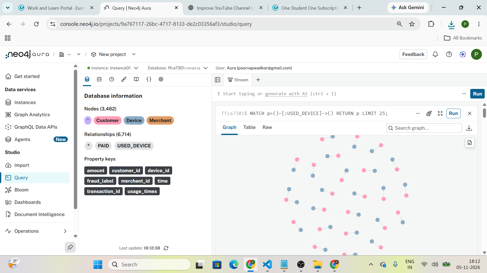
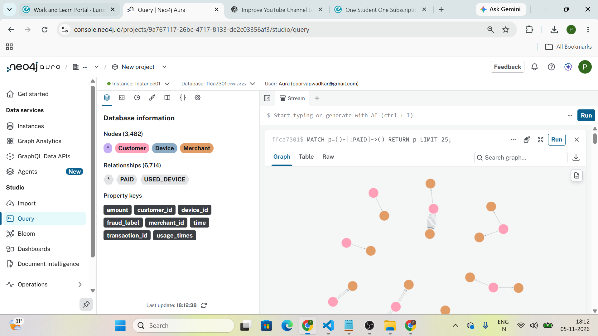
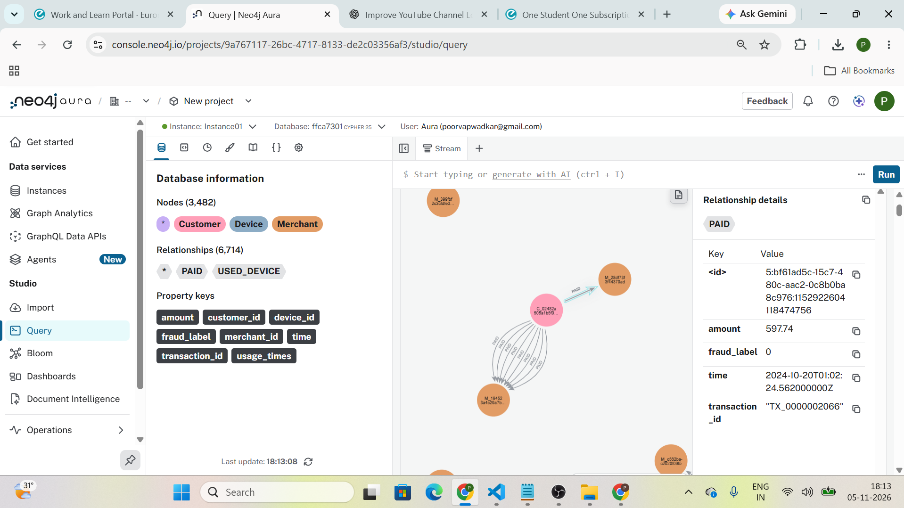
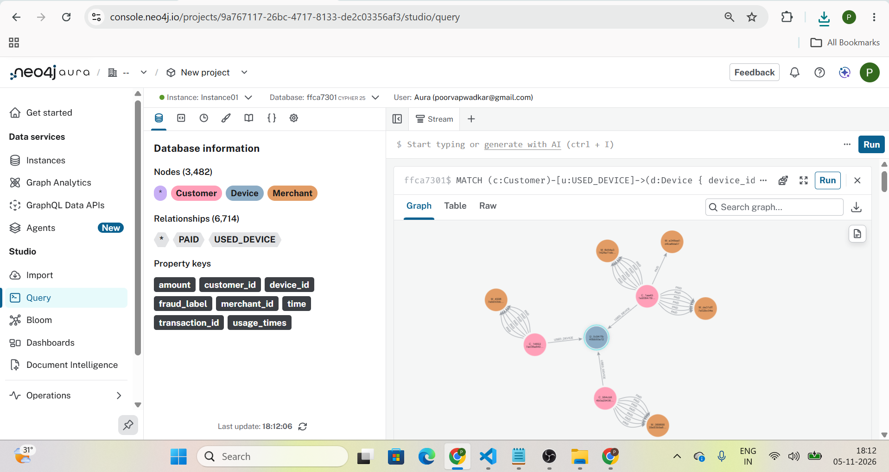

# SENTINEL – Neo4j graph of customers, devices and merchants

## Project Overview

This project models SENTINEL payment data in Neo4j using Customer, Device and Merchant nodes. Python and Cypher are used to load data from Supabase into Neo4j Aura and explore shared devices, connections to fraudulent payments and merchants receiving payments from customers using shared devices. The goal is to identify relationship based fraud patterns for further investigation.

## Project Structure

```text
sentinel-neo4j/
│
├── screenshots/
├── sentinel_neo4j.ipynb
├── .env
├── .env.example       
├── .gitignore
├── requirements.txt
└── README.md
```

### File Description

- `.env` – Stores Supabase and Neo4j credentials.
- `.env.example` – Provides a template for configuring environment variables.


## Setup Steps

### 1. Clone the Repository

```bash
git clone <your-repository-url>
cd sentinel-neo4j
```

### 2. Create and activate a Virtual Environment

```bash
python -m venv venv
```

```bash
venv\Scripts\activate
```

### 3. Install Dependencies

```bash
pip install -r requirements.txt
```

### 4. Configure Environment Variables

Create a `.env` file using the provided `.env.example` file as a template.

Add your database credentials:

```env
SUPABASE_URL=your_supabase_url
SUPABASE_KEY=your_supabase_key

NEO4J_URI=your_neo4j_uri
NEO4J_USERNAME=your_neo4j_username
NEO4J_PASSWORD=your_neo4j_password
```

**Security Note:** Never commit API keys, database credentials or passwords to GitHub. Keep your `.env` file private. The `.env.example` file contains placeholder values and is provided as a configuration template.

## How to Run

1. Ensure that your Supabase project and Neo4j Aura database are accessible.
2. Open `sentinel_neo4j.ipynb` using Jupyter Notebook or VS Code.
3. Run the notebook cells sequentially.

## Project Screenshots

### 1. Customer–Device Relationship



Shows the connection between customers and devices through the `USED_DEVICE` relationship.

### 2. Customer–Merchant Relationship



Shows how customers are connected to merchants through the `PAID` relationship.

### 3. PAID Relationship Properties



The `PAID` relationship stores transaction details such as:
- `amount`
- `time`
- `fraud_label`

### 4. Suspicious Cluster Graph View



Highlights a device shared by three different customers, helping identify potentially suspicious relationship patterns for further investigation.